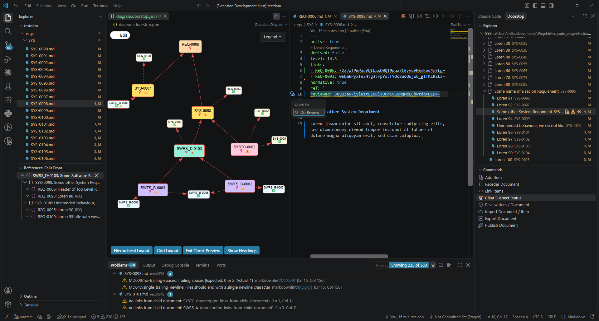
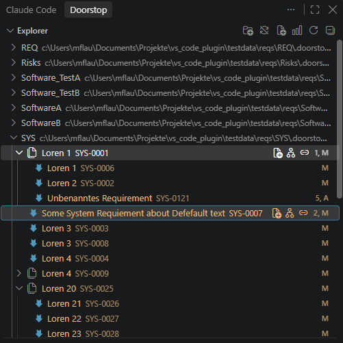
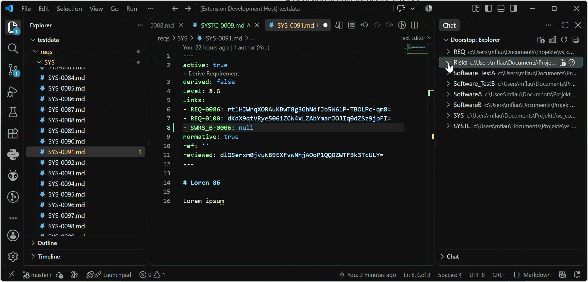
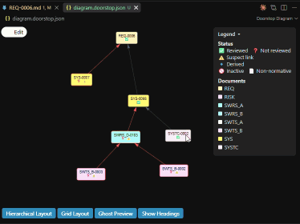
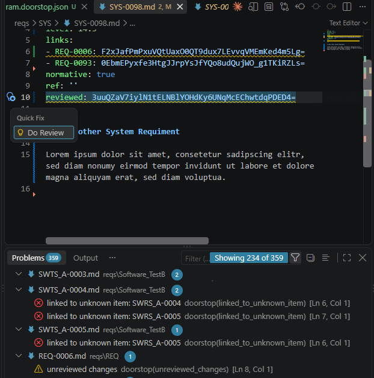
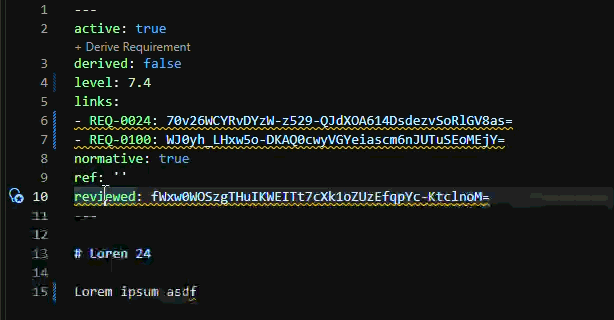
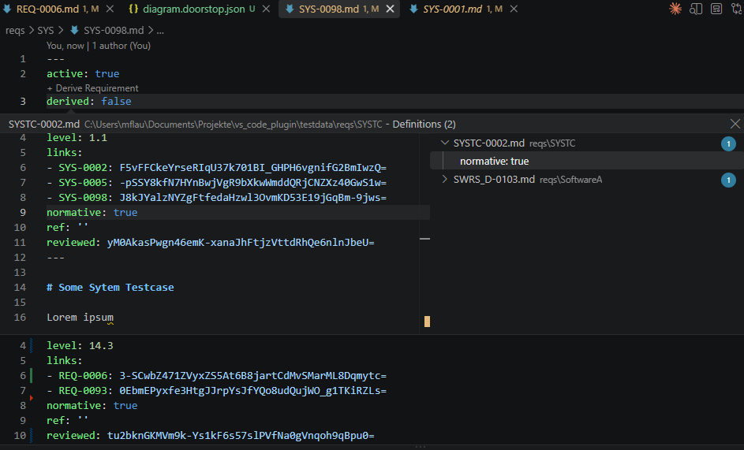
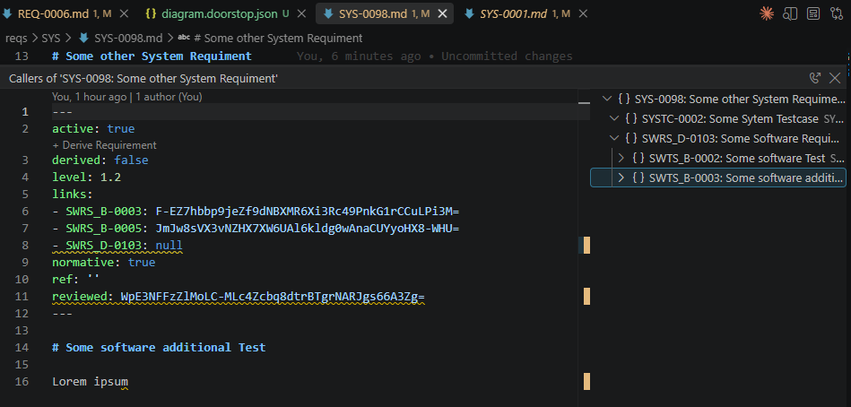
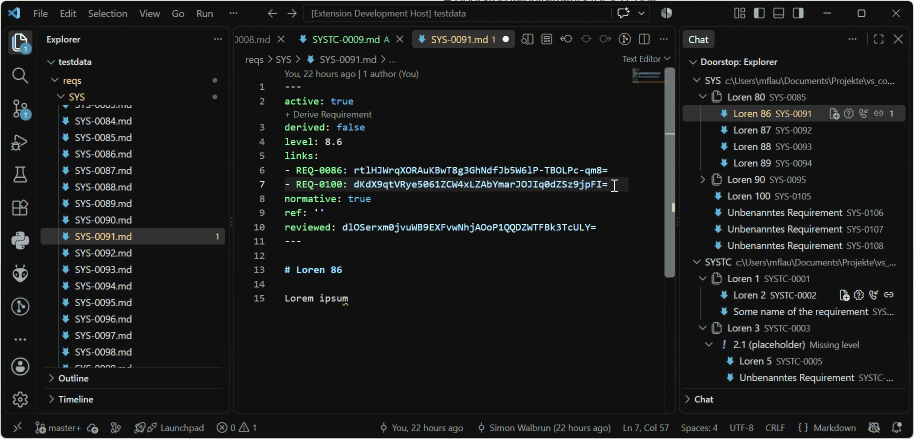
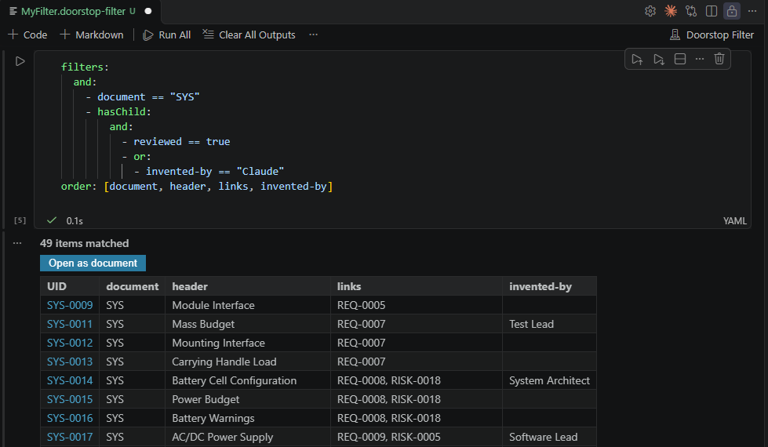

# Doorstop Requirements Management for VS Code

Manage, view and navigate [Doorstop](https://doorstop.readthedocs.io/) requirements without leaving VS Code.
Every Doorstop command is available where you need it: in the explorer, in the editor and on a visual canvas.

## Quick Start

1. Install the [Python extension](https://marketplace.visualstudio.com/items?itemName=ms-python.python) and select a Python ≥ 3.9 environment
2. Open a git folder, with or without an existing Doorstop project
3. Accept the offer to install `doorstop-vscode-server` into that environment
4. Open the **Doorstop** view in the side bar - or **Create Document** to start

## Features

### Explorer

All documents and items in the side bar.

- Items ordered by level, one list per document
- Add, Derive, Review, Link and Clear Suspect per item
- Disable/enable a document with the eye button on its row (adds/removes Doorstop's `.doorstop.skip`; disabling also disables child documents); disabled documents are not validated or modified, which speeds things up
- **Commands** view: Create, Reorder, Import, Export, Publish
- **Generate Status Report**: Mermaid charts of items, problems, changes

### Document View

Edit a whole document as one markdown file - no YAML.

- **Open as document** on a document, section or filter result
- `Ctrl+S` writes only changed items, through Doorstop
- Deletions ask first; broken blocks get a quick fix
- **+ New item below** inserts items in place
- Review, Derive, Link, problems and `F12` work inline
- Show extra header fields via `doorstop.documentView.fields`

### Canvas

Place requirements on a canvas and work with them visually.

- Add, create linked and remove items
- Create and remove links
- Ghost preview of every linked item
- Grid or hierarchical auto layout
- *Doorstop: New Diagram* creates one; `*.doorstop.json` reopens it

### Problems & Quick Fixes

Doorstop's own validation, inline at the affected field.

- **Do Review** and **Clear Suspect Link(s)** via `Ctrl+.`
- Checks in the background on save; **Refresh** re-checks
- The eye button in the tree view cycles **Automatic** / **On demand** / **Off** (`doorstop.problemReporting`)

### Navigation & Traceability

- `F12` jumps to a linked item, `Shift+F12` lists references
- Call hierarchy traces items up- and downstream

### Editor Integration

- **CodeLens:** derive a downstream requirement in one click
- **IntelliSense:** autocomplete links, recent items first
- **Hover:** preview any linked item

### Filter Notebooks

Query items with YAML filters, like Obsidian Bases. Run a cell, get a table.

- Groups: `and:`, `or:`, `not:`, `hasChild:`, `hasParent:`
- Operators: `==` `!=` `<` `<=` `>` `>=`, `.contains()`, `.startsWith()`, `.isEmpty()`, `.isNotEmpty()`
- Works on built-in and custom attributes; levels as strings
- `order: [status, owner]` picks the table columns
- **Open as document** edits the matched items
- *Doorstop: New Filter Notebook* starts with a cheat sheet

### Publish

- HTML, LaTeX and **PDF**, per document or all at once
- Traceability matrix includes cross-document links
- Same output in CI - see [Publish as PDF](doc/publish-pdf.md)

## Settings

| Setting | Default | What it does |
| --- | --- | --- |
| `doorstop.problems` | all on | Problem kinds to show |
| `doorstop.newDocument.itemFormat` | `yaml` | Item format for new documents |
| `doorstop.newDocument.separator` | none | UID separator, e.g. `REQ-001` |
| `doorstop.newDocument.digits` | `3` | UID digits for new documents |
| `doorstop.publish.template` | Doorstop's | Template from the document's `template` folder |
| `doorstop.publish.traceability` | `complete` | `complete` or Doorstop's own matrix |
| `doorstop.publish.noChildLinks` | off | Doorstop's `--no-child-links` |
| `doorstop.documentView.fields` | none | Header fields editable in document views |
| `doorstop.timing.enabled` | off | Timing log, for extension developers |

## Requirements

- VS Code ≥ 1.75 with the Python extension
- Python ≥ 3.9 with `doorstop-vscode-server` (installed on request)
- Node.js ≥ 18 - only for PDF publishing

## Links

[Changelog](CHANGELOG.md) · [Issues](https://github.com/simonwalbrun-lab/doorstop-vscode/issues) · [License](LICENSE.md)
