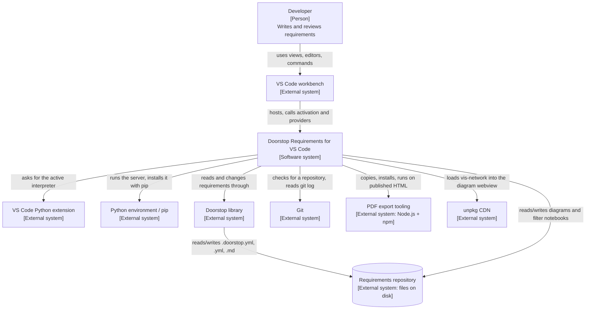
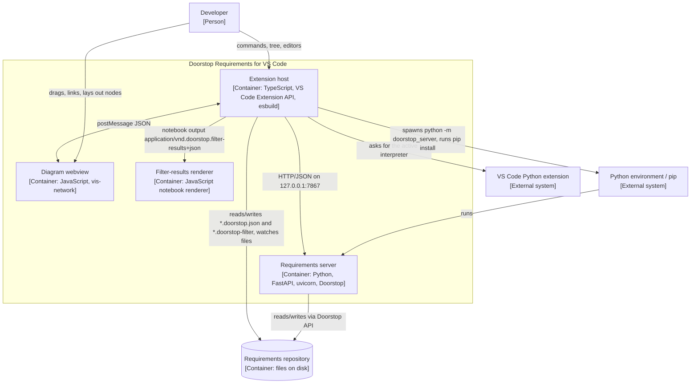
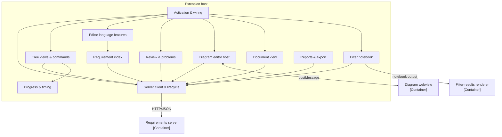
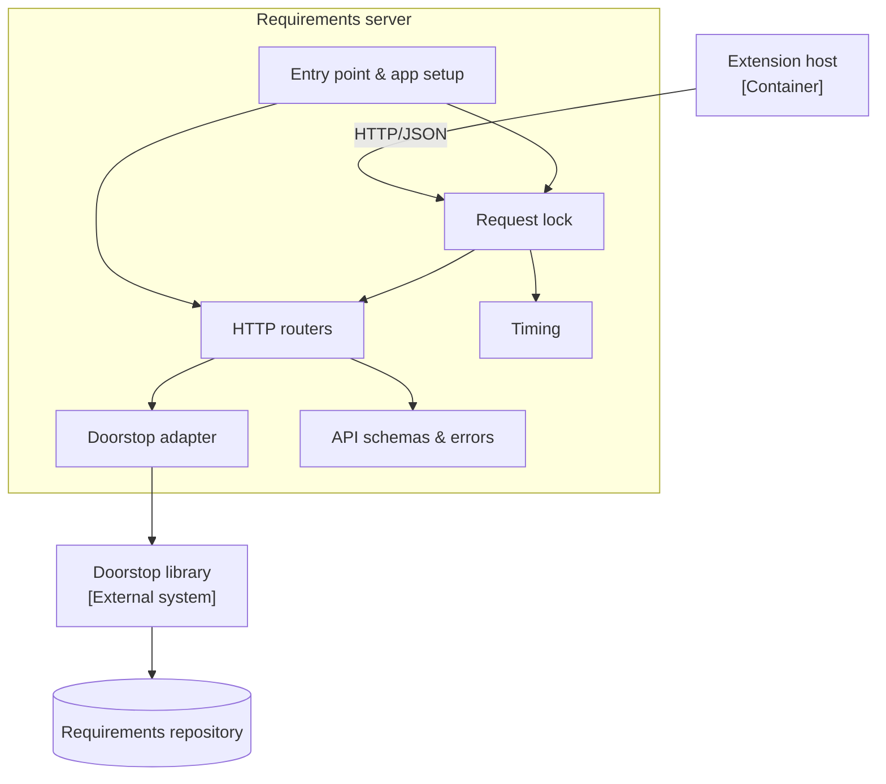
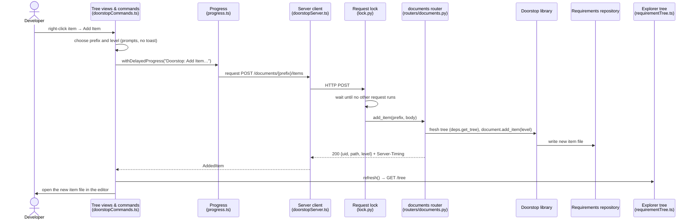

# Architecture

**Up to date with spec:** 033

**Pending specs:** 032

## 1. Overview

Doorstop Requirements for VS Code lets developers read, edit, link, review, and publish
[Doorstop](https://doorstop.readthedocs.io/) requirements without leaving the editor. It
has two halves: a TypeScript VS Code extension that owns every UI surface, and a local
Python server that wraps the Doorstop library and is the only part that understands or
changes the requirements. Read this document top-down: the C4 levels 1–3 (sections 2–5)
zoom from the system's surroundings to the source files, then section 6 shows one request
end to end, and sections 7–8 explain the rules and decisions behind the design.

This document is the current architecture description and supersedes the notes in
[`doc/arc42/`](arc42/). Quality goals and stakeholders are still described in
[`doc/arc42/2000_introduction_and_goals.md`](arc42/2000_introduction_and_goals.md).

| C4 element type | Meaning here |
|-----------------|--------------|
| Person | Someone using the system |
| Software system | Doorstop Requirements for VS Code as a whole |
| External system | Something the system uses but this repository does not build |
| Container | A separately running or separately delivered part (process, webview, data store) |
| Component | A group of source files inside one container with one responsibility |

## 2. Level 1 – System Context



| Element | Type | Role |
|---------|------|------|
| Developer | Person | Writes, links, reviews, and publishes requirements in VS Code. |
| Doorstop Requirements for VS Code | Software system | This repository: extension + local server. |
| VS Code workbench | External system | Hosts the extension; provides tree views, editors, notebooks, diagnostics, CodeLens, webviews. |
| VS Code Python extension | External system | Reports the active Python interpreter the server must run with (`ms-python.python`). |
| Python environment / pip | External system | Runs the server package `doorstop-vscode-server`; pip installs it on request. |
| Doorstop library | External system | Parses, validates, links, reorders, imports/exports, and publishes requirements. |
| Requirements repository | External system | The user's files: Doorstop documents and items, `*.doorstop.json` diagrams, `*.doorstop-filter` notebooks. |
| Git | External system | Required before creating documents; its log feeds the project status report. |
| PDF export tooling | External system | A headless-browser Node script copied into the user's repository and run on published HTML. |
| unpkg CDN | External system | Serves `vis-network` to the diagram webview. |

## 3. Level 2 – Containers



| Container | Technology | Responsibility | Source |
|-----------|------------|----------------|--------|
| Extension host | TypeScript, VS Code Extension API, bundled with esbuild | Every UI surface and command; talks to the server for all requirement data. | `src/*.ts` |
| Diagram webview | JavaScript, vis-network | Interactive traceability canvas inside the `doorstop.diagram` custom editor. | `src/webview/diagram/` |
| Filter-results renderer | JavaScript notebook renderer | Shows the result table of a filter notebook cell. | `src/webview/filterResults/` |
| Requirements server | Python, FastAPI, uvicorn, Doorstop | The single source of truth for requirement data; serializes all requests. | `server/src/doorstop_server/` |
| Requirements repository | `.doorstop.yml`, `.yml`, `.md`, `*.doorstop.json`, `*.doorstop-filter` files | The user's project on disk. | user workspace |
| Python environment / pip | External system shown for context | Interpreter chosen in the Python extension; runs and installs the server. | — |

| From | To | What flows |
|------|----|------------|
| Extension host | Requirements server | Spawns it as a child process; HTTP/JSON requests on `127.0.0.1:7867` (`src/doorstopServer.ts`). |
| Extension host | Diagram webview | `postMessage` JSON both ways (`src/diagrammPanel.ts`, `src/webview/diagram/messaging.js`). |
| Extension host | Filter-results renderer | Notebook cell output with MIME type `application/vnd.doorstop.filter-results+json` (`src/filterNotebook.ts`, `package.json`). |
| Requirements server | Requirements repository | Reads and writes Doorstop documents and items through the Doorstop API. |
| Extension host | Requirements repository | Reads/writes diagram and filter-notebook files; watches `.doorstop.skip` and requirement files. |
| Extension host | Python environment / pip | Asks the Python extension for the active interpreter, runs `pip install doorstop-vscode-server`. |

The Developer and the VS Code Python extension in the diagram are described in section 2.

## 4. Level 3 – Components: Extension host



| Component | Responsibility | Source |
|-----------|----------------|--------|
| Activation & wiring | Activates the extension, picks the interpreter, starts the server, and registers every view, provider, editor, and command. | `src/extension.ts` |
| Server client & lifecycle | Spawns, health-checks, restarts, and installs the server and sends every HTTP request; holds the shared response types. | `src/doorstopServer.ts`, `src/pythonEnvironment.ts`, `src/doorstopTypes.ts` |
| Requirement index | The one client-side lookup of documents and items, built only from `GET /tree`. | `src/doorstopIndex.ts` |
| Tree views & commands | The Explorer and Commands views and the commands behind them (add, link, review, reorder, import/export, publish, create/skip document, derive). | `src/requirementTree.ts`, `src/commandsProvider.ts`, `src/doorstopCommands.ts`, `src/deriveProvider.ts` |
| Editor language features | Hover previews, UID completion, go-to-definition/references, and the link call hierarchy for requirement files. | `src/hoverProvider.ts`, `src/completionProvider.ts`, `src/definitionProvider.ts`, `src/callHierarchyProvider.ts` |
| Review & problems | Shows Doorstop's validation as diagnostics and offers review / clear-suspect CodeLenses and quick fixes. | `src/problemsProvider.ts`, `src/reviewLensProvider.ts`, `src/reviewCodeActionProvider.ts` |
| Diagram editor host | The `doorstop.diagram` custom editor: loads and saves `*.doorstop.json`, feeds the webview, turns canvas actions into server requests. | `src/diagrammPanel.ts` |
| Document view | Serves one Doorstop document as a single editable Markdown text (`doorstop-document` scheme) and writes edits back as item changes. | `src/documentViewProvider.ts`, `src/documentViewModel.ts`, `src/documentViewLanguage.ts` |
| Filter notebook | The `doorstop-filter` notebook: runs each YAML filter cell through `POST /filter`. | `src/filterNotebook.ts` |
| Reports & export | Project status report from tree, validation, and git log; PDF export tooling setup and run. | `src/statusReport.ts`, `src/pdfExport.ts` |
| Progress & timing | Progress toasts for work still running after one second; optional execution timing of commands and server requests. | `src/progress.ts`, `src/timing.ts` |

The neighbouring containers in the diagram (Requirements server, Diagram webview, Filter-results renderer) are described in section 3.

## 5. Level 3 – Components: Requirements server



| Component | Responsibility | Source |
|-----------|----------------|--------|
| Entry point & app setup | Parses `--project/--host/--port`, builds the FastAPI app with one worker, and provides the per-request Doorstop tree (fresh for changes, cached for reads). | `server/src/doorstop_server/__main__.py`, `server/src/doorstop_server/cli.py`, `server/src/doorstop_server/app.py`, `server/src/doorstop_server/config.py`, `server/src/doorstop_server/deps.py` |
| Request lock | ASGI middleware that lets exactly one request run at a time (except `/health`) and adds a `Server-Timing` header. | `server/src/doorstop_server/lock.py` |
| HTTP routers | The REST API: health, tree, items, documents (add, reorder, import, export, publish, skip), review/clear, validation, filters. | `server/src/doorstop_server/routers/health.py`, `server/src/doorstop_server/routers/tree.py`, `server/src/doorstop_server/routers/items.py`, `server/src/doorstop_server/routers/documents.py`, `server/src/doorstop_server/routers/review.py`, `server/src/doorstop_server/routers/validation.py`, `server/src/doorstop_server/routers/filters.py` |
| Doorstop adapter | Builds and fingerprints the Doorstop tree, turns Doorstop's validation messages into structured issues. | `server/src/doorstop_server/doorstop_tree.py`, `server/src/doorstop_server/validation_rules.py` |
| API schemas & errors | Pydantic request/response models and the handlers that turn every exception into `{"error": {"code", "message"}}`. | `server/src/doorstop_server/schemas.py`, `server/src/doorstop_server/errors.py` |
| Timing | Collects wait/load/work durations per request for the `Server-Timing` header. | `server/src/doorstop_server/timing.py` |

The Extension host, Doorstop library, and Requirements repository in the diagram are described in sections 2 and 3.

## 6. Dynamic view – change a requirement

Example: **Add Item** from the Explorer tree view (command `doorstop.add`).



| # | Step | Where |
|---|------|-------|
| 1 | The developer runs Add Item; the command resolves the document prefix and level, asking only when needed. | `src/doorstopCommands.ts` |
| 2 | Only the server call is wrapped in a progress toast that appears if it is still running after one second. | `src/progress.ts` |
| 3 | The server client sends `POST /documents/{prefix}/items`. | `src/doorstopServer.ts` |
| 4 | The request lock waits until no other request is running. | `server/src/doorstop_server/lock.py` |
| 5 | The router builds a fresh Doorstop tree and asks Doorstop to add the item, which writes the file. | `server/src/doorstop_server/routers/documents.py`, `server/src/doorstop_server/deps.py` |
| 6 | The response carries the new UID, path, and level; failures come back as `{"error": …}` and are shown as an error message. | `server/src/doorstop_server/errors.py` |
| 7 | The extension refreshes the tree views (which reload `GET /tree`) and opens the new file. | `src/requirementTree.ts`, `src/commandsProvider.ts` |

Other changes (link, review, reorder, edits in the document view or diagram) follow the
same path with a different endpoint.

## 7. Cross-cutting concepts

**Server start-up and connection.** On activation the extension asks the VS Code Python
extension for the active interpreter (no PATH fallback), checks that the server package is
installed (offering `pip install` if not), spawns `python -m doorstop_server --project …`
and polls `GET /health` until it answers. A changed interpreter restarts the server. A
taken port is reported with a hint. (`src/extension.ts`, `src/doorstopServer.ts`,
`src/pythonEnvironment.ts`, `server/src/doorstop_server/routers/health.py`; specs 001, 016, 029.)

**One request at a time.** The server runs with one worker, and its request lock lets one
request run at a time so no two changes race on the same files (constitution Principle I).
Read-only requests (`/tree`, `/validate`, `/filter`) share a cached tree that is rebuilt
when the file fingerprint changes; changing requests always build a fresh tree.
Cancelling a running request is allowed by Principle I but not implemented yet; spec 032
adds it. (`server/src/doorstop_server/lock.py`, `server/src/doorstop_server/deps.py`.)

**Progress feedback.** Any user-triggered work still running after one second shows a
progress toast until it ends; prompts are never covered (Principle VII, spec 026).
(`src/progress.ts`.)

**Error handling.** The server turns every exception into a structured
`{"error": {"code", "message"}}` response; the extension shows it as an error message
and falls back to what is on disk instead of dropping state (Principle III).
(`server/src/doorstop_server/errors.py`, `src/doorstopServer.ts`.)

**Diagram persistence.** Diagrams are `*.doorstop.json` files opened in a custom editor;
they store workspace-relative requirement paths and use VS Code's own Save, Save As,
Revert, and backup (constitution Additional Constraints; specs 007, 008, 025).
(`src/diagrammPanel.ts`.)

## 8. Key decisions

| Decision | Reason | Source |
|----------|--------|--------|
| The server is the single source of truth; the extension never parses requirement files for data. | Client-side parsing disagreed with Doorstop's own state. | Principle I |
| Use Doorstop's API for every Doorstop capability; never reimplement it. | One implementation to trust and to fix. | Principle II |
| A long-running local HTTP server instead of a Doorstop call per action. | Keeps the tree warm and gives one place that serializes changes. | Principle I, spec 001 |
| Exactly one request at a time; cancellation only for a closed list of reasons. | Prevents concurrent writes; lets long read-only work give way. | Principle I, spec 032 |
| Validation messages are classified on the server. | Recognising Doorstop's messages is Doorstop knowledge. | Principle I, spec 014 |
| Graph rendering and interaction via vis-network. | Do not hand-roll layout, dragging, zoom. | Additional Constraints, specs 007, 008 |
| PDF tooling lives in the user's repository. | VS Code and CI run the very same copy. | spec 027 |
| No new dependency without written justification. | Smaller install footprint and supply-chain surface. | Principle IV |

## 9. How to update this document

Do this as part of every spec's work, before the spec is considered done:

1. Set **Up to date with spec** to the spec just implemented and remove it from **Pending specs**.
   A spec that is specified but not yet implemented goes into **Pending specs**.
2. New, renamed, or removed source file in `src/`, `src/webview/`, or `server/src/doorstop_server/`:
   add, rename, or remove it in the matching component row of section 4 or 5.
3. New container, external system, or communication path: update sections 2 and 3.
4. New cross-cutting rule or constitution principle: update sections 7 and 8.
5. No architectural change: only step 1.

Two specs developed in parallel: on a merge conflict in the marker, keep the higher number
after checking that both specs are reflected.

Optional self-check (Git Bash, repository root), which should print nothing:

```bash
for f in src/*.ts src/webview/* server/src/doorstop_server/*.py server/src/doorstop_server/routers/*.py; do
  case "$f" in *__init__.py) continue;; esac
  grep -qF "$f" doc/architecture.md || echo "missing: $f"
done
grep -oE '(src|server)/[A-Za-z0-9_./-]+' doc/architecture.md | sort -u | while read p; do
  [ -e "${p%.}" ] || echo "stale: $p"
done
```
